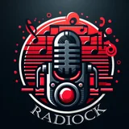
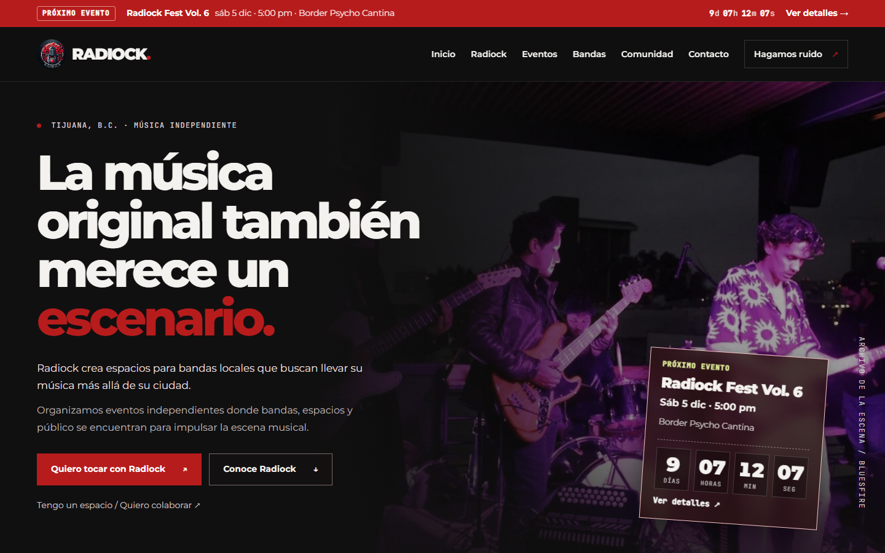
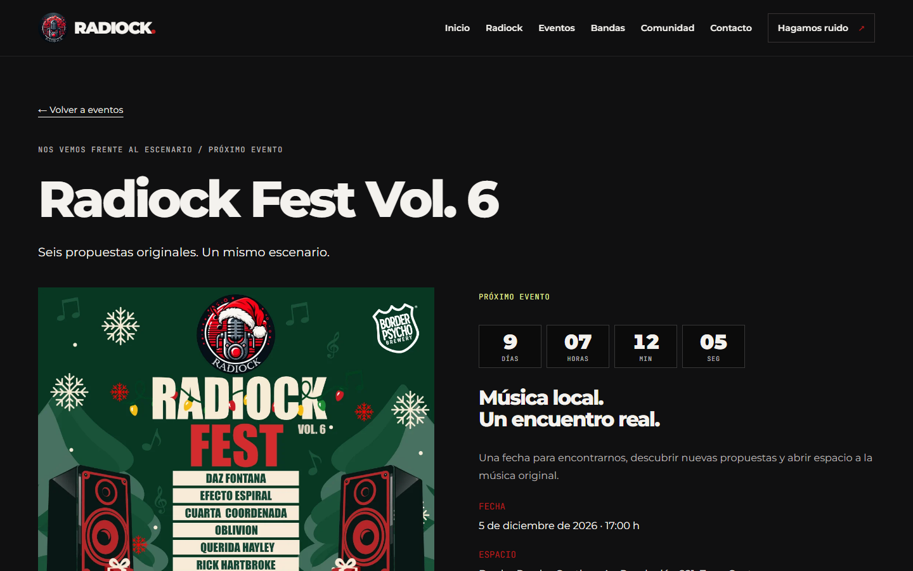
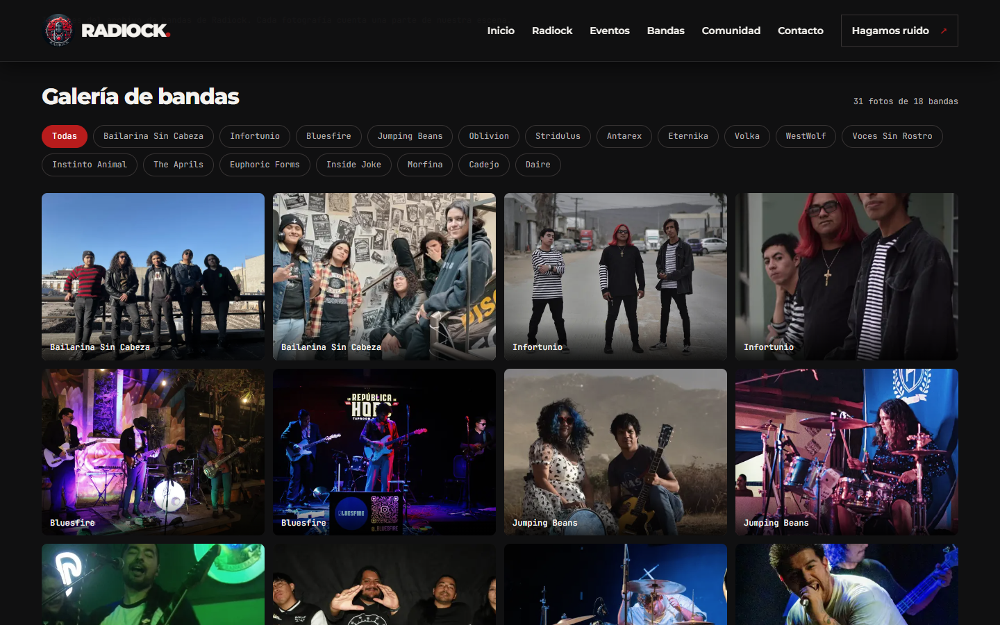
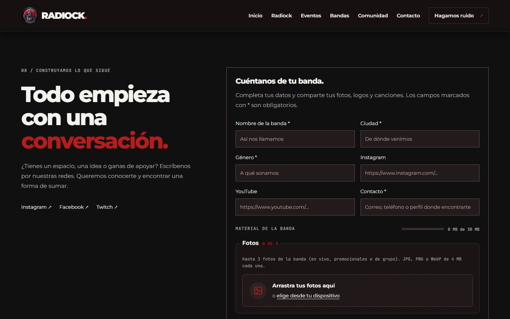
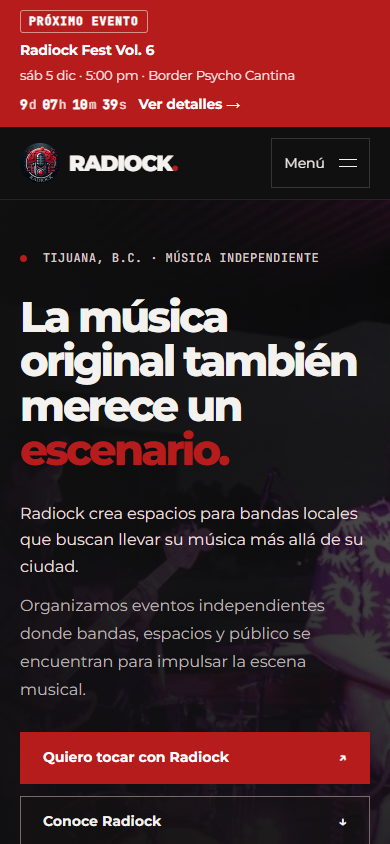

# Radiock

Sitio web para un colectivo de eventos musicales independientes en Tijuana.

[Ver sitio en vivo](https://radiock-escena.j3nny153000.chatgpt.site/)

 

## El proyecto

Radiock organiza conciertos para bandas locales con música original. Necesitaba un sitio que promocionara sus eventos, mostrara su trayectoria y recibiera solicitudes de bandas y espacios sin depender solo de redes sociales.

**Resultado:** un sitio rápido y en línea, con 6 ediciones de eventos documentadas, 18 bandas y 4 espacios aliados.

## Qué incluye

- **Aviso del próximo evento** con cuenta regresiva en vivo.
- **Página por evento** con cartel, fecha, lugar y bandas.
- **Galería de bandas** con filtros y visor de fotos.
- **Sección de espacios aliados**.
- **Registro de bandas en línea**: datos, fotos, logos y canciones que llegan directo a Google Drive.
- **Diseño responsive**, pensado primero para móvil.

<table>
  <tr>
    <td width="50%"></td>
    <td width="50%"></td>
  </tr>
  <tr>
    <td width="50%"></td>
    <td width="50%" align="center"></td>
  </tr>
</table>

## Stack

- Astro
- HTML
- CSS
- JavaScript
- Google Apps Script
- Google Drive

## ¿Quieres algo similar?

Ideal para bandas, festivales, foros, colectivos o cualquier proyecto que necesite mostrar eventos y recibir registros.

Escríbeme por [GitHub](https://github.com/JenniferLlamas).

## Licencia

El código está bajo licencia [MIT](LICENSE). Las imágenes, logos, fotos y textos pertenecen a Radiock y a las bandas y espacios participantes, y no se incluyen en esta licencia.
